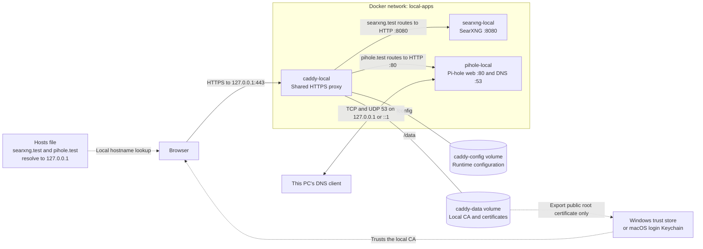

# Caddy Local

A shared HTTPS entry point for local Docker apps on Windows and macOS. This is the only stack that publishes ports 80 and 443. It routes by hostname over the external Docker network `local-apps`:

| URL | Upstream container service |
| --- | --- |
| https://searxng.test | `searxng:8080` |
| https://pihole.test/admin/ | `pihole:80` |

Both HTTP hostnames redirect to HTTPS. `http://localhost:8888` redirects to SearXNG. All published ports bind to `127.0.0.1`, so these sites are available only on this machine. `.test` is reserved for testing.

## Architecture



Caddy terminates browser HTTPS and forwards HTTP over the Docker network. HTTP on port 80 redirects to HTTPS; port 8888 provides the localhost redirect to SearXNG. Pi-hole DNS goes directly to port 53 and keeps working when Caddy is stopped. The CA private key stays in Caddy's data volume; only its public root certificate is installed on the host.


## Windows setup

Install and start Docker Desktop with Linux containers, then:

```powershell
git clone https://github.com/rohandhamapurkar/caddy-local.git
cd caddy-local
powershell -NoProfile -ExecutionPolicy Bypass -File .\initialize.ps1
```

Run the hosts helper from this folder in an **administrator PowerShell**:

```powershell
powershell -NoProfile -ExecutionPolicy Bypass -File .\set-local-host.ps1
```

It adds missing localhost mappings after backing up the hosts file, and refuses conflicting entries. Back in regular PowerShell:

```powershell
docker compose up -d
powershell -NoProfile -ExecutionPolicy Bypass -File .\trust-local-ca.ps1
```

If the CA is not ready yet, retry the trust helper after a few seconds. The helper exports only the public root certificate and installs it in the current user's Windows root trust store. Restart browsers if needed.

## macOS setup

Install and launch Docker Desktop for your Mac, then:

```bash
git clone https://github.com/rohandhamapurkar/caddy-local.git
cd caddy-local
bash ./setup-macos.sh
```

Run without sudo: the hosts step requests sudo itself. Certificate trust goes into your login Keychain and may prompt for authorization. If necessary, import the exported `caddy-local-root.crt` in Keychain Access and set SSL trust to Always Trust. macOS-specific Keychain and DNS commands have not been verified on a Mac in this development environment.

## App stacks

Start the apps independently:

- [SearXNG Local](https://github.com/rohandhamapurkar/searxng-local): joins `local-apps` as `searxng`, port 8080.
- [Pi-hole Local](https://github.com/rohandhamapurkar/pihole-local): joins `local-apps` as `pihole`, port 80. DNS works independently of this proxy.

If an app is stopped, its HTTPS route returns a proxy error while other routes keep working. Caddy has no Compose dependency on either app stack. Stopping or recreating Caddy does not stop the app containers or Pi-hole DNS.

## Add another local app

Join its container to external network `local-apps`, add a hostname block in `Caddyfile` using `tls internal` and `reverse_proxy service-name:port`, then add that hostname to your hosts file. On Windows, the hosts helper accepts `-Names` for custom `.test` hostnames; on macOS, update its hostname list or edit hosts manually. Reload after validation:

```text
docker compose exec -T caddy caddy validate --config /etc/caddy/Caddyfile
docker compose exec -T caddy caddy reload --config /etc/caddy/Caddyfile
```

## Persistent CA and migration

Volumes `caddy-local_caddy-data` and `caddy-local_caddy-config` belong to this stack. Caddy stores the CA private key and certificates in the data volume and automatically renews leaf certificates. Each fresh installation creates its own CA; never share the private key or publish volume contents.

When extracting an existing Caddy from another stack, stop its container before copying `/data` and `/config` into this stack's volumes, preserving ownership and permissions. Do not run both proxies on the same host ports. Preserve the original volumes until trusted HTTPS has been verified after the move. Copying the existing data retains its CA, so already configured browsers do not need another root trust installation.

## Management and removal

- Start: `docker compose up -d`
- Stop: `docker compose stop`
- Logs: `docker compose logs --tail 100`
- Update: `docker compose pull`, then `docker compose up -d`
- Remove containers but preserve the CA: `docker compose down`

Do not use `down -v` unless you intend to delete the CA and certificates. To remove trust, match the fingerprint of the exported root certificate with the corresponding root in Windows Certificate Manager or macOS Keychain Access, then remove that root and its trust settings. Remove the local hosts mappings if no longer needed.

Changing Caddy does not restore Windows DNS. Restore Pi-hole DNS using the Pi-hole repository's `dns.ps1 -Action Restore` before stopping its container or Docker Desktop.

Official reference: https://caddyserver.com/docs/automatic-https
